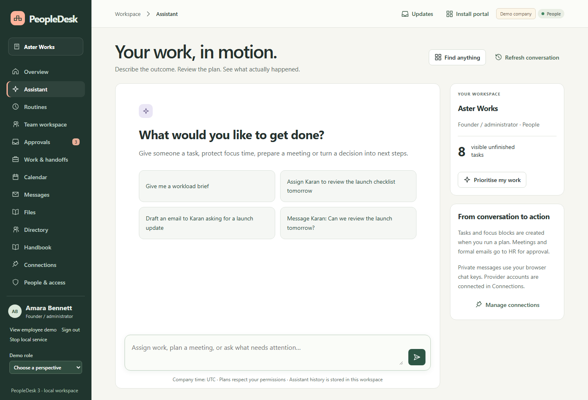
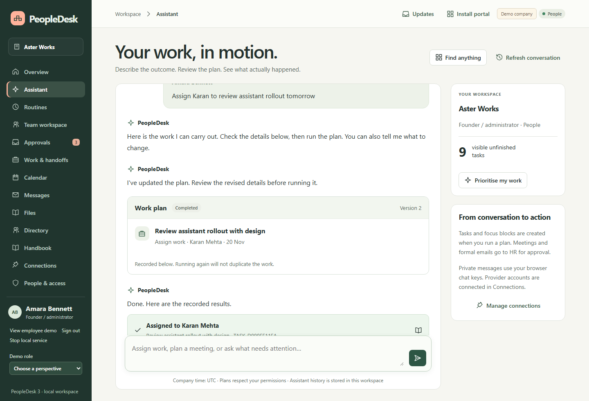

# PeopleDesk

### AI-assisted workplace workflows, with people in control.

Turn a work request into a reviewable plan, a saved task and a result you can open. PeopleDesk brings employee portals, HR approvals, calendars, task routines and private conversations into one Windows-first, self-hosted prototype.

**Created by [Ayushman Choudhary](https://github.com/ayushman0404).** Interested in something similar? [Work with me](#work-with-ayushman).



[Get started](#get-started) · [Demo](docs/DEMO.md) · [Architecture](docs/ARCHITECTURE.md) · [Security](SECURITY.md)

## What you can do

| Workflow | Result |
| --- | --- |
| Ask the assistant to assign work | Inspect the person, task and due date, then run the plan and open the saved result. |
| Revise a request | Update supported dates and times before execution; stale versions cannot run. |
| Draft a formal email | A local model drafts the email; approval and external delivery remain separate. |
| Turn notes into a handoff | Review source-linked actions, owners and dates before promoting them into work. |
| Organise recurring work | Create weekday task routines, pause them and inspect recorded runs. |
| Use personalised portals | Employees, managers, HR and administrators see work appropriate to their roles. |
| Coordinate privately | Direct or fixed-membership group conversations with browser-side encryption. |
| Connect company tools | Google sign-in, Calendar, Gmail, Drive and Tasks, plus Zoom meeting creation. |

Google/Zoom require your provider configuration and consent. Sync is on demand. Messaging uses a prototype cryptographic protocol with [documented limits](SECURITY.md).

## Try one complete flow

1. Open the demo and choose **Assistant**.
2. Enter **Assign Karan to review the launch checklist tomorrow**.
3. Check the details and select **Run plan**.
4. Open the receipt to inspect the saved task.
5. With the local model installed, try **Draft an email to Karan asking for a launch update**. Running it creates a pending approval request.



The fictional Aster Works company contains 32 employees and seeded policies, leave records and work items. No private company dataset is included.

## Get started

### Windows portable app

If a Windows asset is available on the [Releases page](https://github.com/ayushman0404/peopledesk/releases), download **PeopleDesk-3-Windows.zip**, extract it fully, and open **PeopleDesk-3/PeopleDesk.exe**. Keep the adjacent **Handoff-Studio** folder: it contains the model and runtime. No Python or paid model API key is needed.

The executable is unsigned. Review the source and decide whether you trust the build before running it.

### Run from source

Windows and Python 3.12 are the supported development environment. In PowerShell:

```powershell
git clone https://github.com/ayushman0404/peopledesk.git
cd peopledesk
py -3.12 -m venv .venv
.\.venv\Scripts\python.exe -m pip install -r requirements.txt
.\.venv\Scripts\python.exe PeopleDesk/app.py
```

The demo opens on **http://127.0.0.1:8878**. Forms, records and supported command parsing work without model weights. Drafting and handoff extraction need the [local model setup](docs/MODEL.md).

Start a separate company workspace:

```powershell
.\.venv\Scripts\python.exe PeopleDesk/app.py --company
```

Use the private setup link opened by the app to create its first administrator. See [company setup and integrations](docs/SETUP.md). A shared company needs one running server; separate installations do not share data.

## How it works

A supported request becomes a plan. The server checks the account, fields and version, then writes local changes in a transaction. A completed plan keeps its receipt, so retrying that same plan returns its result.

A small local Qwen model supports drafting and interpretation. Record queries and permission checks remain in code. Some common commands use explicit parsing. The assistant can misunderstand; inspect the preview.

See [architecture](docs/ARCHITECTURE.md) and [assistant behaviour](docs/ASSISTANT.md).

## Development checks

```powershell
.\.venv\Scripts\python.exe -m pip install -r requirements-dev.txt
.\.venv\Scripts\python.exe scripts/check.py
```

Default checks exercise local APIs, registration, access controls, approvals, provider contracts using doubles, action replay and routines. To include local-model checks after installing the engine:

```powershell
$env:PEOPLEDESK_TEST_MODEL = "1"
.\.venv\Scripts\python.exe scripts/check.py
```

Read [validation scope](docs/VALIDATION.md). Passing authored checks is not a model-accuracy score, security audit or production-scale benchmark.

## Current boundaries

This is a working prototype for evaluation and carefully scoped pilots. It has no independent security audit, production-load benchmark or measured customer impact. Native calls, screen sharing, enterprise SSO and statutory payroll are not included.

Calendar/routine times are UTC. The server must stay running for routines. Source is MIT-licensed; hosting, hardware and external services may cost money.

## Work with Ayushman

I'm **Ayushman Choudhary**, the creator of this project. I'm open to discussing custom internal tools, workflow automation and AI-assisted prototypes for businesses and individual clients.

Send me the process you want to improve, tools involved, desired outcome, timeline and approximate budget if available. We can discuss a small prototype and agree on scope and deliverables before starting. Please use fictional examples initially; do not send employee records, passwords or API keys.

**Email:** [ayushman0404@gmail.com](mailto:ayushman0404@gmail.com)

**Phone:** [+91 9727131288](tel:+919727131288)

**GitHub:** [@ayushman0404](https://github.com/ayushman0404)

PeopleDesk was developed with substantial AI assistance for code and testing. Contributions and review are welcome: [CONTRIBUTING.md](CONTRIBUTING.md).

## License

Application source: [MIT](LICENSE). Third-party components retain their own licenses: [THIRD-PARTY.md](THIRD-PARTY.md).
