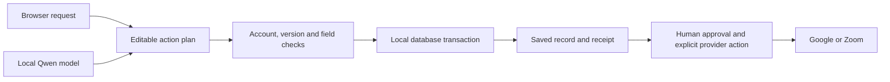

# Architecture

A Python HTTP service owns SQLite records and serves a browser client. The supported deployment is one Windows service with one company database, not a multi-tenant hosted service.

The model suggests content; it has no database/provider tools. Common commands also use explicit parsing.

| Source | Responsibility |
| --- | --- |
| PeopleDesk/app.py | HTTP server, sessions and routing |
| PeopleDesk/records.py | Schema, fictional data and record helpers |
| PeopleDesk/company.py | Membership, roles, assignments and file access |
| PeopleDesk/copilot.py | Conversation, plans, revisions and execution receipts |
| PeopleDesk/routines.py | Weekday tasks and permission rechecks |
| PeopleDesk/assistant_hr.py | Local inference and record-backed answers |
| Handoff-Studio/pipeline.py | Source-linked note extraction |
| PeopleDesk/service.py | Approval workflows and provider dispatch |
| PeopleDesk/cloud.py / providers.py | Connections and external adapters |
| PeopleDesk/messaging.py / web/messages.js | Ciphertext storage and browser encryption |
| PeopleDesk/web/ | Browser interface |
| tests/ | API, access, assistant, routine and browser checks |

A completed plan returns its existing receipt when replayed. A new plan ID is a distinct request, even with the same task title. Local transactions can roll back local writes; external calls cannot be rolled back this way. Unknown provider outcomes require verification.

Ordinary records and assistant history are stored on the server. Private chat uses browser encryption, but metadata remains visible and malicious server-delivered JavaScript can defeat it. See [SECURITY.md](../SECURITY.md).
