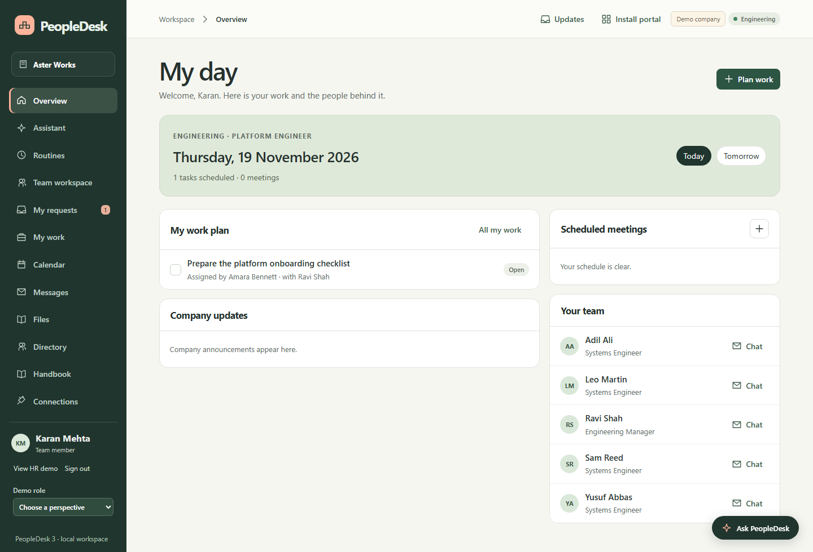
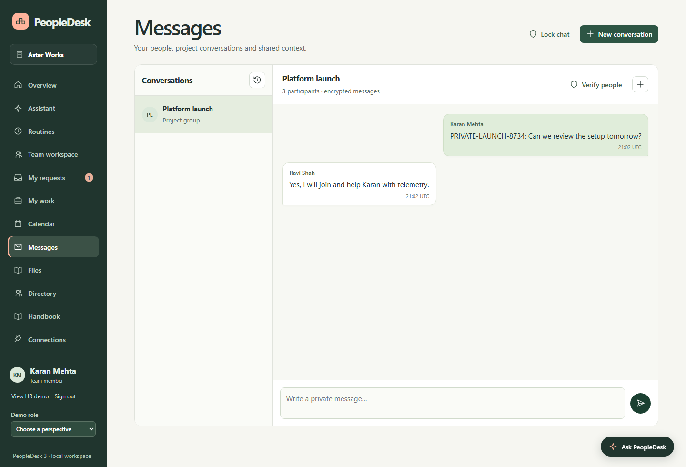

# Product walkthrough

Use the fictional company. Demo records persist between launches, so prior edits can change what you see.

1. In Assistant, ask **Assign Karan to review the launch checklist tomorrow**. Inspect the plan, run it, then open its saved task.
2. Switch to Karan in the demo role selector and update the assignment's progress. Use separate browser profiles for simultaneous accounts.
3. With the local model installed, request an email draft to Karan. Run the plan and inspect the pending approval. It has not sent an email.
4. Create a weekday task routine with a future UTC time. Keep the server running and inspect the recorded run when due. Pause it after the demonstration.
5. Activate chat for two fictional accounts using separate passphrases, then create a conversation. Read the security limitations first.

Live integrations require company mode, provider credentials and consent. A demo meeting is not a confirmed Google or Zoom booking. For a client discussion, show their relevant workflow first and ask where their process differs.
